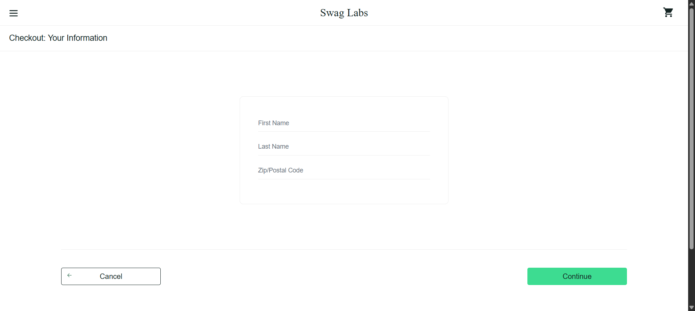

# BUG-001: Checkout Allowed with an Empty Shopping Cart

**Module:** Shopping Cart / Checkout

**Severity:** Major

**Priority:** High

**Environment:**
- Application: SauceDemo
- OS: Windows 11
- Browser: Google Chrome

**Preconditions:**
- User is logged in successfully.
- Shopping cart is empty.

**Steps to Reproduce:**
1. Open SauceDemo and log in.
2. Make sure the shopping cart contains no products.
3. Open the Shopping Cart page.
4. Click the Checkout button.

**Expected Result:**

The system should prevent the user from proceeding to checkout when the shopping cart is empty.

**Actual Result:**

The system allows the user to proceed to the checkout process despite having no products in the shopping cart.

**Status:** Failed

**Evidence:** Screenshot to be attached.

**Test Case Reference:** TC-19 – Checkout with Empty Cart