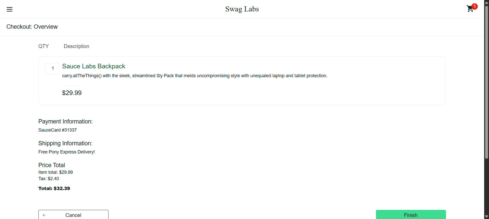

# BUG-002: First Name Field Accepts Numeric Values

**Bug ID:** BUG-002

**Module:** Checkout – Your Information

**Severity:** Medium

**Priority:** High

**Environment:**
- Application: SauceDemo
- OS: Windows 11
- Browser: Google Chrome 157
- Selenium: 4.51.0

**Preconditions:**
- User is logged in successfully.
- At least one product is added to the shopping cart.
- User has navigated to the Checkout: Your Information page.

**Steps to Reproduce:**
1. Enter numeric values in the First Name field (e.g., `12345`).
2. Enter a valid Last Name.
3. Enter a valid Postal Code.
4. Click Continue.

**Expected Result:**

The system should reject numeric-only values in the First Name field and display an appropriate validation message.

**Actual Result:**

The system accepts numeric-only values in the First Name field and allows the user to proceed to the next checkout step.

**Test Case Reference:** TC-35 – First Name Contains Numbers

**Status:** Failed

**Evidence:** Screenshot to be attached.

**Test Case Reference:** TC-35:Purchase - First Name Checkout Validation