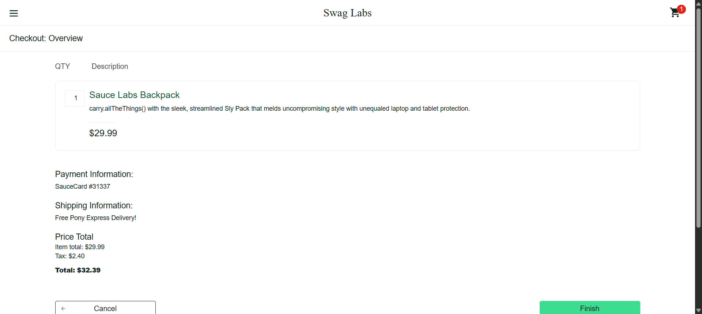

# BUG-003: Last Name Field Accepts Special Characters

**Bug ID:** BUG-003

**Module:** Checkout – Your Information

**Severity:** Medium

**Priority:** High

**Environment:**
- Application: SauceDemo
- OS: Windows 11
- Browser: Google Chrome 157
- Selenium: 4.51.0

**Preconditions:**
- User is logged in successfully.
- At least one product is added to the shopping cart.
- User has navigated to the Checkout: Your Information page.

**Steps to Reproduce:**
1. Enter a valid First Name.
2. Enter special characters in the Last Name field (e.g., `@#$%`).
3. Enter a valid Postal Code.
4. Click Continue.

**Expected Result:**

The system should reject invalid special characters in the Last Name field and display an appropriate validation message.

**Actual Result:**

The system accepts special characters in the Last Name field and allows the user to proceed to the next checkout step.

**Test Case Reference:** TC-36 – Last Name Contains Symbols

**Status:** Failed

**Evidence:** Screenshot to be attached.

**Test Case Reference:** TC-36:Purchase - Last Name Checkout Validation