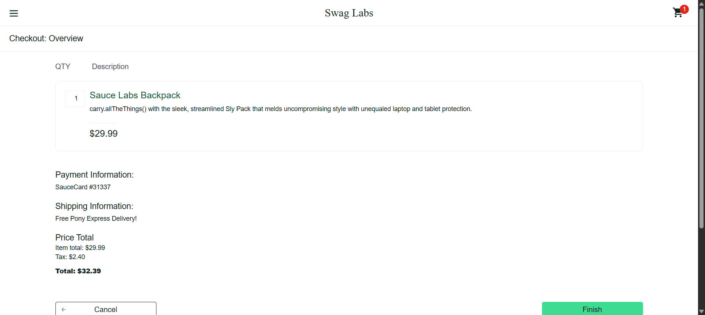

# BUG-004: Postal Code Field Accepts Alphabetic Characters

**Bug ID:** BUG-004

**Module:** Checkout – Your Information

**Severity:** Medium

**Priority:** High

**Environment:**
- Application: SauceDemo
- OS: Windows 11
- Browser: Google Chrome 157
- Selenium: 4.51.0

**Preconditions:**
- User is logged in successfully.
- At least one product is added to the shopping cart.
- User has navigated to the Checkout: Your Information page.

**Steps to Reproduce:**
1. Enter a valid First Name.
2. Enter a valid Last Name.
3. Enter alphabetic characters in the Postal Code field (e.g., `ABCDE`).
4. Click Continue.

**Expected Result:**

The system should reject alphabetic characters in the Postal Code field and display an appropriate validation message.

**Actual Result:**

The system accepts alphabetic characters in the Postal Code field and allows the user to proceed to the next checkout step.

**Test Case Reference:** TC-37 – Postal Code Contains Letters

**Status:** Failed

**Evidence:** Screenshot to be attached.

**Test Case Reference:** TC-37:Purchase - Postal Code Checkout Validation